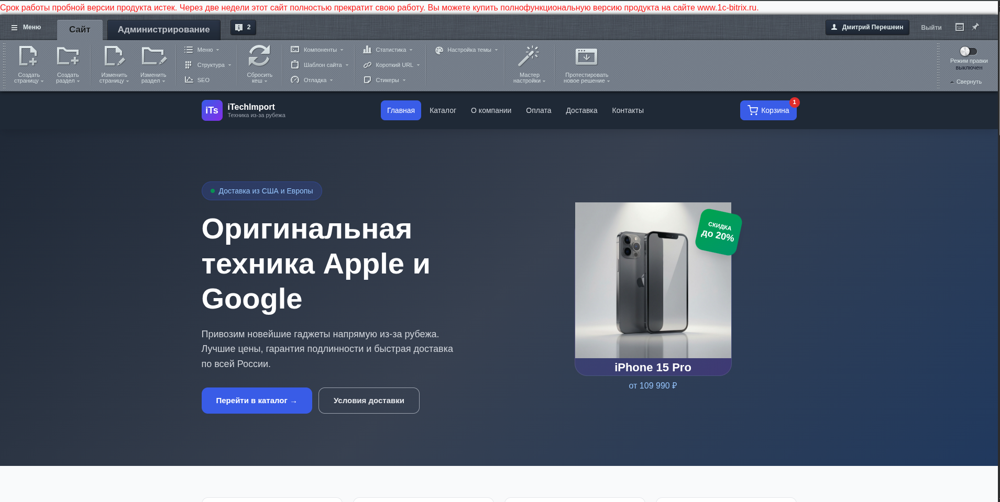
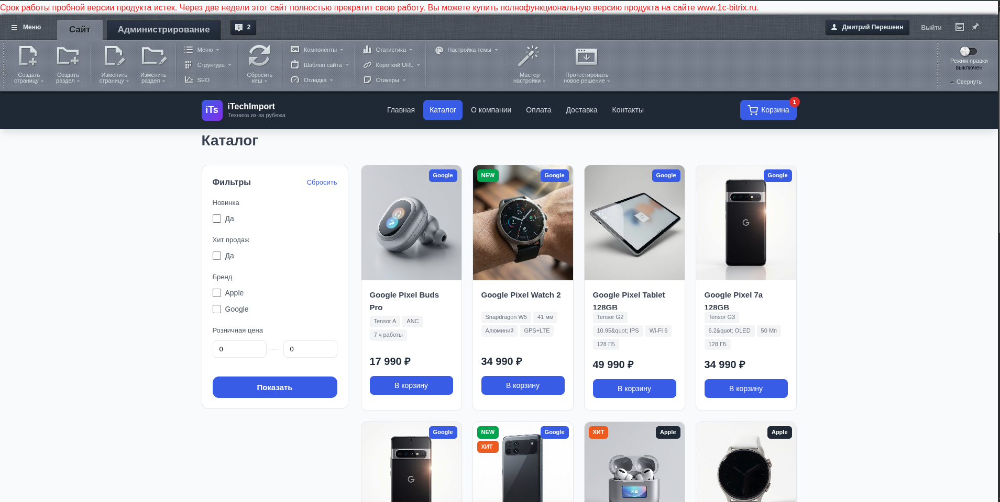
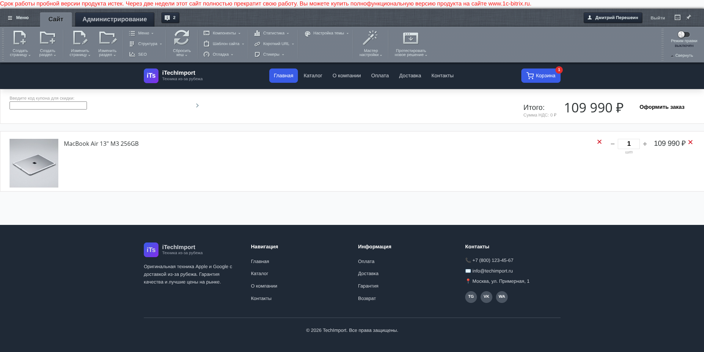
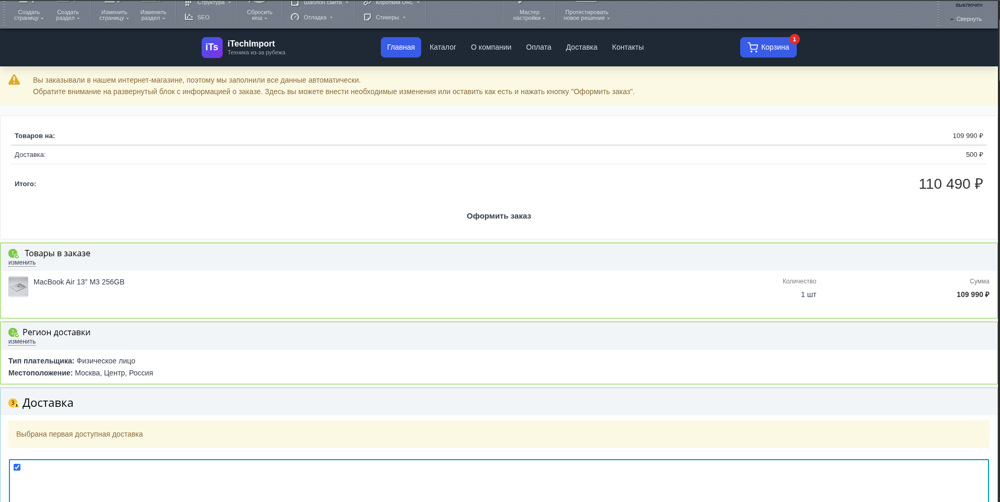
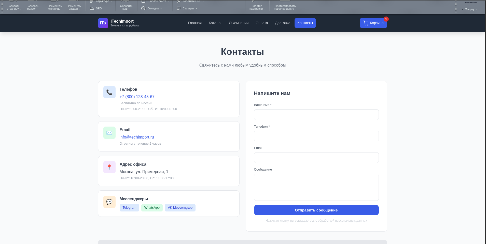
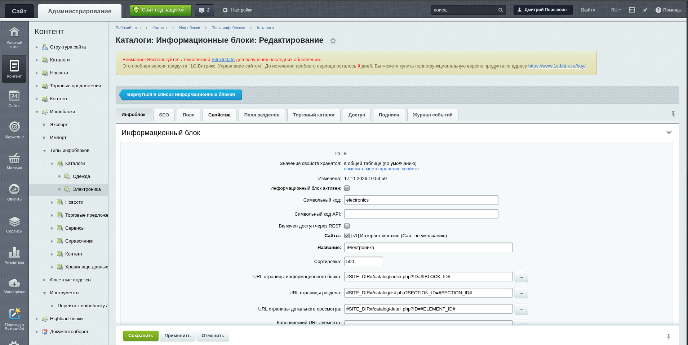
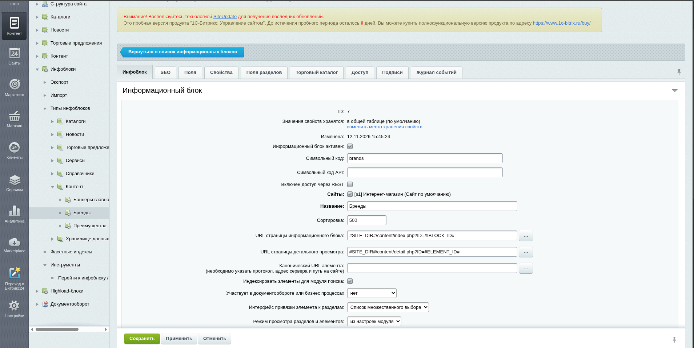
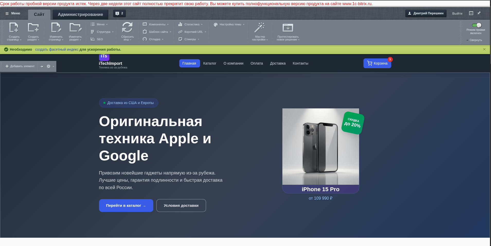

# iTechImport — интернет-магазин электроники на 1С-Битрикс

Учебный интернет-магазин оригинальной техники Apple и Google. Проект демонстрирует
полный сценарий e-commerce на 1С-Битрикс (D7): каталог с AJAX-фильтром, корзину,
оформление заказа и интеграцию с веб-формами.

> **Статус демо:** Bitrix-версия развёрнута на ознакомительной (триальной) лицензии
> и не предназначена для публичного развёртывания. Репозиторий содержит только
> кастомный код (`/local/`) и каркасы страниц — без ядра и базы данных. Оценка
> проекта — по скриншотам и описанию архитектуры ниже.

---

## 🎯 Задача и роль

**Задача:** создать витрину интернет-магазина с управляемым каталогом, чтобы
менеджер мог добавлять товары и менять контент без участия разработчика.

**Моя роль:** полный цикл — от настройки Docker-окружения и структуры инфоблоков
до кастомных компонентов, шаблонов, AJAX-фильтрации и веб-форм.

---

## 🛠️ Стек

- **CMS:** 1С-Битрикс: Управление сайтом (D7)
- **Языки:** PHP 8.2, JavaScript, HTML5, CSS3
- **Окружение:** Docker (`bitrix/env-docker`: nginx, php-fpm, mysql, redis, memcached)
- **Инструменты:** Git, VS Code

---

## 🏗️ Ключевые архитектурные решения

### 1. Каталог через `bitrix:catalog` со связкой `$component`

Каталог построен на комплексном компоненте `bitrix:catalog` с кастомным шаблоном
`sections.php`. Умный фильтр (`catalog.smart.filter`) и список товаров
(`catalog.section`) вызываются с **одним и тем же объектом `$component`** —
это штатный механизм Битрикса, который даёт фильтру возможность обновлять
список без перезагрузки. Без патчей `script.js`, без ручных `BX.ajax.insertToNode`,
без хаков с `COMPONENT_CONTAINER_ID`.

### 2. Разделение данных и представления

Контентные блоки страниц («О компании», «Оплата», «Доставка», CTA) вынесены
во **включаемые области** (`IncludeFile`). Обёртки-контейнеры (`.steps`, `.info-cards`,
`.delivery-cards`) остаются в `index.php` — менеджер не может случайно сломать
grid/flex. Контакты (телефон, email, адрес) хранятся в **одной области** и
переиспользуются в футере, CTA и на странице «Контакты».

### 3. Кастомные шаблоны `news.list` для витрины

Блоки «Хиты продаж», «Новинки», «Преимущества», «Бренды» на главной — это
`bitrix:news.list` с кастомными шаблонами (`hits_slider`, `advantages`,
`brands_main`). Свойства `IS_NEW`, `IS_HIT`, `BRAND_REF`, `SPECS` описаны
в инфоблоке «Электроника» и выводятся в шаблоне через `$arItem['PROPERTIES']`.

### 4. Мини-корзина через `sale.basket.basket.line`

Счётчик в шапке — не статичный ``, а компонент `bitrix:sale.basket.basket.line`
с кастомным шаблоном. Он сам подписан на событие `OnBasketChange` и обновляет
счётчик без перезагрузки страницы. Шаблон скопирован в `/local` и переверстан
под `.header__cart` с SVG-иконкой.

### 5. AJAX-добавление в корзину

Кнопка «В корзину» на главной работает через собственный AJAX-эндпоинт
`/local/ajax/add-to-basket.php`, который использует современный D7-API
`\Bitrix\Catalog\Product\Basket::addProduct()`. После добавления вызывается
`BX.onCustomEvent('OnBasketChange')` — мини-корзина обновляется сама. Это
обходной путь для триальной сборки, где `catalog.section` не генерирует
`ADD_URL`/`BUY_URL`.

### 6. Кастомизация корзины через `/local`

Шаблон `sale.basket.basket` скопирован из `bootstrap_v4` в `/local` и
переверстан под дизайн (`cart-page`, `cart-item`, `cart-summary`). Колонка
«цена за 1 шт» удалена через `js-templates/basket-item.php`. Фильтр и лишние
табы скрыты через `style.css` шаблона.

### 7. Веб-форма обратной связи

Форма на странице «Контакты» — штатный модуль «Веб-формы»
(`bitrix:form.result.new` с кастомным шаблоном `custom`). Заявки сохраняются
в админке (**Сервисы → Веб-формы → Результаты**), на почту уходят уведомления
по почтовому шаблону. Поля стилизованы под `.contact-form__input` /
`.contact-form__textarea`.

### 8. Управление правами в Docker

Для корректной работы админки настроены UID/GID (979) и права `775/664`
на файлы шаблона. Это устранило ошибку «Ошибка при создании файла» при
редактировании включаемых областей через режим правки.

---

## 🛒 Пользовательский сценарий

Проект показывает полный путь покупателя:

**Главная** → **Каталог с фильтром** → **Корзина** → **Оформление заказа** → **Заявка в админке**.

---

## 📸 Скриншоты

### Публичная часть

] !(docs/main-2.png)
*Главная: хиты продаж, новинки, бренды, CTA. Все блоки — на `news.list` с кастомными шаблонами.*

*Каталог: `bitrix:catalog` с AJAX-фильтром. Слева — умный фильтр (бренд, цена, новизна, хит), справа — сетка `.product-card`.*

![Каталог с применённым фильтром (docs/catalog-filter-2.png)] ![(docs/catalog-filter.png)]
*Применён фильтр «Apple»: список обновился без перезагрузки, в URL — параметры фильтра.*

*Корзина: кастомный шаблон `sale.basket.basket`, переверстан под `.cart-page` и `.cart-item`. Колонка «цена за 1 шт» удалена.*

*Оформление заказа через `sale.order.ajax` — форма с контактами, доставкой и оплатой.*

*Контакты: телефон/email/адрес из включаемых областей, форма — `bitrix:form.result.new` с кастомным шаблоном.*

![Другие страницы (docs/delivery.png)] ![(docs/payment.png)]

### Администрирование

 ![(docs/info-catalog-2.png)]
*Инфоблок «Электроника»: свойства `BRAND_REF` (привязка к брендам), `SPECS` (множественное), `IS_NEW`, `IS_HIT`, `OLD_PRICE`.*

] ![(docs/info-brands2.png)]
*Инфоблок «Бренды»: элементы `Apple` и `Google`, привязанные к товарам через `BRAND_REF`.*

![Результаты веб-форм (docs/form.png)]
*Результаты веб-форм: заявка с формы «Контакты» сохранена в админке.*

 ![(docs/catalog-edit.png)]

## 📂 Структура проекта
